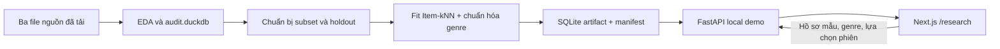

# Music4All-Onion — bản gợi ý đầu tiên chạy local

## Bản này làm được gì?

Chuẩn bị dữ liệu thật → tách train/holdout → fit Item-kNN → tạo artifact → FastAPI → giao diện Next.js tại `/research`.

- Tra cứu theo ID bài, genre và tags; lọc genre, phân trang và xem đặc trưng.
- Chọn một người dùng nghiên cứu để sử dụng lịch sử train, hoặc thử người mới.
- Chọn thể loại yêu thích và tối đa 5 bài làm ngữ cảnh phiên.
- Nhận Top-10, xem điểm cộng tác/nội dung/độ phổ biến và lý do chính.
- Loại bài có trong lịch sử train và ngữ cảnh; xử lý cold start bằng content/popularity.

**Chưa có tên bài, nghệ sĩ, album hoặc audio trong những file đã tải.** `Track <ID>` chỉ là nhãn giao diện. Nút chọn bài mô phỏng ý định, không ghi nhận một lượt nghe thật. Không giả lập tên, không ánh xạ ngẫu nhiên sang Jamendo/iTunes. Không có phát nhạc, đăng nhập hoặc xu hướng theo thời gian trong bản nghiên cứu này.

## Dữ liệu đầu vào và bước chuẩn bị

Nguồn là Music4All-Onion v2, hồ sơ nguồn được lưu trong manifest tải dữ liệu và báo cáo EDA. Không cần tải toàn bộ release.

| File nguồn | Nội dung | Xử lý |
|---|---|---|
| `userid_trackid_count.tsv.bz2` | `user_id`, `track_id`, `count` | Số lượt nghe tổng hợp, không phải chuỗi sự kiện có thời gian |
| `id_genres_tf-idf.tsv.bz2` | ID và 685 chiều thể loại | Kiểm tra hữu hạn/không âm, chuẩn hóa L2; vector zero giữ rỗng |
| `id_tags_dict.tsv.bz2` | ID và từ điển tag/trọng số dạng text | `ast.literal_eval`, hợp nhất tag trùng bằng max, giữ 20 tag trọng số cao nhất để tra cứu |

Các ID được giữ nguyên, phân biệt hoa thường. Tags phục vụ search/hiển thị, chưa được đưa vào vector gợi ý. Không chuyển TF-IDF thành xác suất.

Mặc định lấy 3.000 track có tổng lượt nghe cao nhất trong nguồn, chọn 1.000 user theo hash ổn định, mỗi user phải có ít nhất 5 bài thuộc catalog đó. Giới hạn tối đa 60 cặp/user theo thứ tự hash để fit trên máy cá nhân; không tuyên bố đây là mẫu đại diện toàn bộ dataset.

Mỗi user giữ riêng một cặp làm holdout, phần còn lại train. Đây là **leave-one-out theo hash, không phải temporal split**. Neighbor, hồ sơ user và popularity đều chỉ tính từ train. Tuy nhiên, việc chọn catalog dựa trên tổng lượt nghe của cả nguồn nên đánh giá còn thiên lệch; các metric hiện tại chỉ để kiểm tra baseline, chưa là kết quả nghiên cứu cuối cùng. Holdout không được trả trong endpoint lịch sử.

## Mô hình và kiến trúc



1. **Lọc cộng tác Item-kNN:** lấy tập user đã nghe từng item từ train; tính cosine nhị phân `n_common / sqrt(n_i * n_j)`, nhân hệ số giảm tin cậy `n_common / (n_common + 10)`. Giữ 40 neighbor/item. Tín hiệu user là `log1p(count)`; cộng các similarity neighbor có trọng số để chấm ứng viên. Đây là mô hình memory-based có bước fit neighbor, chưa phải ALS/LightFM.
2. **Lọc nội dung:** genre TF-IDF của mỗi item được chuẩn hóa L2. Hồ sơ user là tổng vector item với trọng số `log1p(count)`, cộng vector genre được chọn và vector các bài trong ngữ cảnh. Chuẩn hóa hồ sơ rồi tính cosine với từng bài.
3. **Ngữ cảnh phiên:** lựa chọn gần nhất có trọng số bổ sung `3 / (vị_trí + 1)`, tối đa 5 bài. Đây là heuristic từ thứ tự chọn trên giao diện; dataset gốc chưa có timestamp trong các file đã tải.
4. **Hybrid ranking:** chuẩn hóa CF bằng điểm CF tối đa, popularity bằng `log1p(train_plays) / log1p(max_train_plays)`. Điểm mặc định `0.5 * CF + 0.4 * content + 0.1 * popularity`. Nhánh không có tín hiệu được bỏ và trọng số còn lại được chuẩn hóa tổng bằng 1. Chưa có tín hiệu nào thì popularity nhận trọng số 1. Loại các bài đã có trong train history/ngữ cảnh và sort điểm giảm dần, tie-break bằng ID.

Rationale hiển thị là thành phần có đóng góp lớn nhất, không phải giải thích nhân quả. Genre ưu tiên là tín hiệu mềm, không bắt buộc mọi bài gợi ý phải thuộc genre đó; bộ lọc catalog thì lọc chính xác genre.

Backend demo là entrypoint riêng `app.research_demo:app`, không import cấu hình `.env` hoặc Supabase. Nó đọc artifact ở startup bằng thread pool, không tạo schema hay train trong request. Route tra cứu/chấm điểm chạy trong FastAPI thread pool để không chặn event loop. SQLite chỉ được mở read-only để nạp artifact, request dùng bộ nhớ. Đây là cách đơn giản cho 3.000 bài; cần index vector/cache hoặc worker khi mở rộng, không khẳng định async làm CPU scoring nhanh hơn.

Catalog Supabase hiện có vẫn giữ nguyên schema, RLS và endpoint. Dữ liệu nghiên cứu có ID khác, thiếu metadata cần thiết, nên chưa nhập vào `songs` của ứng dụng. Thay đổi này thêm baseline nghiên cứu giai đoạn 1; quyết định LightFM ở handoff vẫn là hướng tiếp theo.

## Chạy từ đầu

Yêu cầu: Python >=3.10, uv, Node/npm. Các lệnh dưới chạy từ root repository trừ khi có `cd`. Không cần Docker, Supabase hoặc key.

```bash
uv sync --project backend --dev --locked
uv sync --project recommender/eda --locked
npm ci --prefix frontend
```

Nếu máy mới chưa có ba file nguồn và database EDA, thực hiện trước:

```bash
cd recommender/eda
uv run python download_music4all.py --include-interactions
uv run python music4all_audit.py
cd ../..
```

Bước download cần Internet và tải file interactions khoảng 550 MB. Các bước sau hoạt động offline khi dependencies và dữ liệu đã có.

```bash
# Chọn subset, fit và đánh giá; có thể chạy lại, chỉ thay artifact local
uv run --project recommender/eda python recommender/eda/prepare_research_demo.py

# Backend demo, không dùng app.main và không đọc backend/.env
uv run --project backend uvicorn app.research_demo:app --host 127.0.0.1 --port 8001
```

Terminal khác:

```bash
cd frontend
npm run dev
```

Mở `http://localhost:3000/research`. Giao diện demo mặc định gọi `http://127.0.0.1:8001`; không yêu cầu sửa file env đang có. Khi thay port, truyền biến `NEXT_PUBLIC_RESEARCH_API_BASE_URL` qua shell lúc chạy/build frontend. Backend chỉ cho phép origin localhost/127.0.0.1 cổng 3000.

Artifact mặc định: `data/processed/music4all-demo/catalog.sqlite3`; checksum và metric: `catalog.manifest.json` cùng thư mục. Tất cả nằm dưới `data/` đã được Git ignore. Dùng `MUSIC4ALL_ARTIFACT` để chọn artifact khác. API trả lỗi 503 chung nếu artifact thiếu/hỏng, không tạo database rỗng, không fallback cloud. Restart backend sau khi tạo artifact mới.

## API demo

| Method và endpoint | Chức năng |
|---|---|
| `GET /health` | Liveness; dùng `/research/info` để kiểm tra artifact sẵn sàng |
| `GET /api/v1/research/info` | Manifest, metric, danh sách genre |
| `GET /api/v1/research/tracks` | `query`, `genre`, `limit` 1–100, `offset` >=0; `{total, items}` |
| `GET /api/v1/research/tracks/{id}` | Chi tiết track, ID giữ nguyên kiểu chuỗi |
| `GET /api/v1/research/users` | Hồ sơ nghiên cứu; phân trang, mặc định 20 |
| `GET /api/v1/research/users/{id}/history` | Cặp tương tác train, sort số lượt giảm dần; không phải trình tự thời gian |
| `POST /api/v1/research/recommendations` | `{user_id: null, genres: [], recent_track_ids: [], limit: 10}` |

Recommendation response: `{model, items: [{track_id, score, components: {collaborative, content, popularity}, reason, track}]}`. Track gồm `id`, `display_name`, `genres`, `tags`, `training_plays`, `can_stream: false`. Không trả raw source payload. ID không có trả 404; limit/genre không hợp lệ trả 422.

## Kiểm tra và demo trước lớp

```bash
# Unit riêng cho nghiên cứu, không cần artifact/network
cd backend
uv run pytest tests/test_research_demo.py
# Integration với artifact đã tạo, không gọi HTTP bên ngoài
uv run pytest tests/test_research_integration.py -m research_integration
cd ..

# Full gate trong bản sao loại mọi .env: unit, integration artifact,
# Ruff, compileall, frontend lint/build, git diff --check
uv run --project backend python scripts/check_research_demo.py
```

Gate không đọc/copy `backend/.env`, `frontend/.env.local` hoặc các file `.env*` khác. Nó không chạy integration Supabase. Integration artifact skip rõ ràng nếu chưa chuẩn bị dữ liệu. Không cần backend đang chạy vì test dùng ASGI TestClient local.

Luồng trình bày: mở `/research` → tra cứu `rock` → lọc `pop` → chọn user có lịch sử → mở lịch sử train → xem Top-10 và điểm giải thích → chọn một bài làm ngữ cảnh → xem danh sách thay đổi → chuyển sang người mới để minh họa cold start. Ngữ cảnh chỉ sống trong memory trình duyệt, reload sẽ xóa, chưa có event persistence.

## Kết quả kiểm tra ngày 2026-11-13

Artifact thực tế: 3.000 track, 1.000 user, 44.037 cặp train, 1.000 holdout, 119.792 quan hệ neighbor. Bước chuẩn bị/fit/evaluation mất khoảng 18,86 giây trên môi trường hiện tại (không bao gồm tải dữ liệu hoặc EDA).

| Kiểm tra | Kết quả |
|---|---|
| `prepare_research_demo.py` | Tạo artifact thành công; SQLite integrity và foreign keys hợp lệ |
| Unit: `pytest -q -m 'not integration and not research_integration'` | 36 passed, 2 deselected |
| Artifact integration: `pytest -q -m research_integration` | 1 passed, 37 deselected; dùng dữ liệu thật đã chuẩn bị |
| `ruff check .` tại backend | Passed |
| `ruff format --check .` tại backend | 36 file đã đúng format |
| Ruff check/format script chuẩn bị và gate | Passed |
| `python -m compileall -q app tests` | Passed |
| `npm run lint` | Passed |
| `npm run build` | Passed; route `/research` được build thành công |
| HTTP smoke qua Uvicorn loopback tạm | Health, info, search 5 bài, recommendations 10 bài, CORS: passed |
| `git diff --check` | Passed |

| Baseline, trên 100 user holdout | Recall@10 | NDCG@10 |
|---|---:|---:|
| Popularity | 0,010 | 0,00289 |
| Hybrid Item-kNN + genre + popularity | 0,100 | 0,06781 |

Các metric trên chỉ mô tả một lần chạy smoke trên subset thiên lệch, không chứng minh chất lượng production hoặc hiệu quả theo thời gian. Có một cảnh báo deprecation từ tương thích Starlette/AnyIO trong TestClient; không làm test thất bại. Chưa kiểm thử tương tác giao diện bằng browser tự động; frontend đã lint/type-check/build, backend đã kiểm thử ASGI và HTTP thật. Gate cuối cùng pass toàn bộ sau khi sửa import ordering Ruff.

Các kiểm tra không gọi Supabase cloud, không đọc/sửa các file môi trường riêng, không reset database, không commit/push. TestClient cần chạy ngoài sandbox hạn chế thread/event loop trong môi trường agent hiện tại; không cần thay đổi code ứng dụng vì hạn chế đó.

## Giới hạn và bước tiếp theo

- Mẫu thiên về bài phổ biến, giới hạn lịch sử; kết quả chưa đại diện cho 50 triệu cặp nguồn.
- Đánh giá hiện tại chỉ 100 user, chưa temporal, chưa tune hyperparameter hoặc kiểm định; không dùng để khẳng định hybrid tốt hơn trong mọi trường hợp.
- Cần timestamp để temporal split và xu hướng lịch sử; muốn xu hướng hiện tại cần nguồn cập nhật thực tế.
- Cần metadata/audio được cấp quyền và mapping ID xác minh để tìm theo tên và phát nhạc; không thể tự lấy một link Jamendo thay cho Music4All ID.
- Chưa có authentication, event collection hoặc mô hình ALS/LightFM. Đây là bản gợi ý local có thể chạy, không phải toàn bộ website nghe nhạc hoàn chỉnh.
