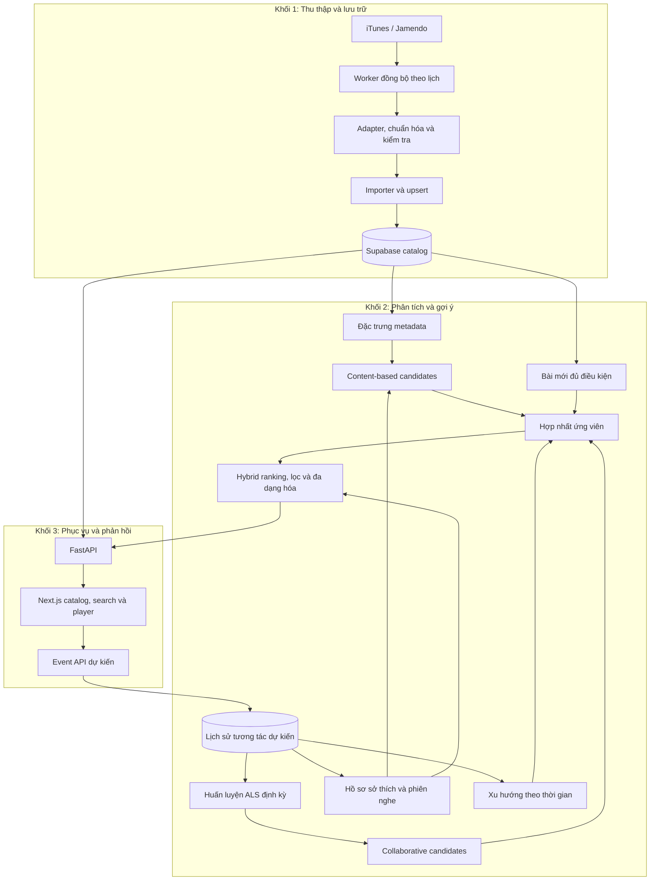
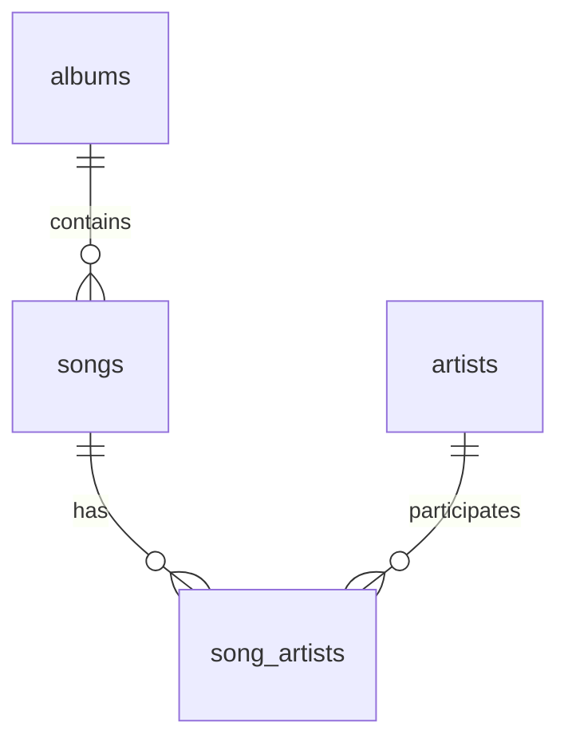

# Thuyết trình: Hệ thống gợi ý âm nhạc cá nhân hóa

> Tài liệu chuẩn bị slide và lời thuyết trình cho dự án môn học.
> Đối chiếu repository ngày 30/10/2026. Các ví dụ dữ liệu và điểm số là minh họa, không phải kết quả thực nghiệm.
> Kiến trúc gợi ý trong tài liệu là phương án dự kiến; không đồng nghĩa với toàn bộ tính năng đã được triển khai.

## 1. Cách sử dụng tài liệu

Mỗi phần trình bày một nội dung của hệ thống: bài toán, dữ liệu, xử lý, kiến trúc, phương pháp và đánh giá. Có thể rút các ý chính thành slide và dùng phần giải thích làm ghi chú khi nói.

Trình tự kể chuyện:

```text
Bài toán thực tế
→ Dữ liệu cần có
→ Phân tích và chuẩn hóa dữ liệu
→ Kiến trúc tổng thể
→ Chi tiết từng thành phần
→ Các phương pháp gợi ý
→ Luồng sử dụng và đánh giá
→ Tiến độ và hướng phát triển
```

### 1.1. Phân biệt hiện trạng và thiết kế

| Thành phần | Trạng thái theo code và handoff |
|---|---|
| FastAPI, health endpoint, Catalog API | Đã có implementation |
| Migration catalog, RLS và seed demo | Đã có file SQL |
| Next.js catalog, tìm theo title, tải thêm | Đã có implementation |
| Player cơ bản | Đã có; chỉ phát các bài đáp ứng playback contract |
| Adapter iTunes và Jamendo | Đã có thử nghiệm lấy và chuẩn hóa dữ liệu |
| Nhận diện một số truy vấn mood tiếng Việt | Đã có rule-based normalization ở provider service |
| Import dữ liệu provider vào Supabase | Chưa triển khai |
| Đồng bộ tự động theo lịch | Chưa triển khai |
| Xác thực, lịch sử nghe, tracking tương tác | Chưa triển khai |
| Content-based, ALS, hybrid ranking | Thiết kế dự kiến, chưa có mô hình được huấn luyện |
| Xu hướng từ tương tác và đánh giá recommendation | Chưa triển khai |
| R2, audio feature extraction, deployment | Chưa nằm trong phần đã hoàn thành |

Tài liệu này không xác nhận trạng thái database cloud hoặc kết quả chạy test tại thời điểm thuyết trình. Việc có migration trong repository không chứng minh migration đã được áp dụng lên một database cụ thể.

### 1.2. Lựa chọn mô hình cần thống nhất

Các slide gần đây sử dụng content-based + Implicit ALS + xu hướng. Trong khi đó, `PROJECT_HANDOFF.md` trước đây chọn LightFM-WARP/Hybrid cho giai đoạn nghiên cứu.

Tài liệu này diễn giải ALS theo slide hiện tại như một phương án thử nghiệm. Quyết định LightFM trong handoff vẫn được giữ nguyên; cần thống nhất lại trước khi triển khai mô hình. Có thể đánh giá ALS như baseline lọc cộng tác và LightFM-Hybrid như phương án kết hợp interaction với item features. Không tuyên bố một mô hình tốt hơn trước khi có kết quả đo.

## 2. Giới thiệu bài toán

Người dùng đứng trước một catalog âm nhạc lớn nhưng khó lựa chọn bài phù hợp. Tìm kiếm theo từ khóa giúp tìm một bài đã biết, còn gợi ý cần chủ động tìm ra những bài người dùng có thể muốn nghe tiếp.

Sở thích có hai mức: gu dài hạn hình thành từ lịch sử và nhu cầu tức thời thể hiện qua phiên nghe hoặc tìm kiếm gần đây. Một người thường nghe ballad vẫn có thể muốn nghe nhạc sôi động trong phiên hiện tại.

Bài mới và xu hướng thay đổi liên tục. Bài mới chưa có tương tác nên khó được mô hình chỉ dựa trên lịch sử đề xuất; bài có nhiều lượt nghe trong quá khứ cũng chưa chắc còn là xu hướng hiện tại.

### Ý chính trên slide

- Catalog lớn khiến người dùng khó tìm bài phù hợp và khám phá bài mới.
- Sở thích thể hiện qua lịch sử nhưng thay đổi theo phiên nghe và ý định tìm kiếm.
- Cần cân bằng cá nhân hóa, xu hướng gần đây và khả năng đưa bài mới vào gợi ý.
- Dữ liệu mới, thiếu tương tác và khác biệt giữa các nguồn tạo ra bài toán cold-start và chuẩn hóa.

### Lời nói gợi ý

> Bài toán của nhóm là lựa chọn những bài phù hợp cho từng người tại từng thời điểm. Hệ thống cần hiểu cả sở thích lâu dài, nhu cầu hiện tại và những thay đổi của catalog, thay vì chỉ đưa cùng một danh sách phổ biến cho tất cả người dùng.

## 3. Phân tích dữ liệu

### 3.1. Ba nhóm dữ liệu có vai trò khác nhau

| Nhóm | Nguồn | Vai trò |
|---|---|---|
| Catalog âm nhạc | iTunes, Jamendo | Metadata, tìm kiếm, liên kết playback và đặc trưng nội dung |
| Tương tác người dùng | Website của dự án, dự kiến thu thập | Học sở thích, lịch sử phiên và xu hướng nội bộ |
| Benchmark nghiên cứu | Dataset công khai, nếu chọn sử dụng | Đánh giá offline các thuật toán trên dữ liệu lớn hơn |

Seed demo là dữ liệu giả lập để kiểm thử catalog, không đại diện cho dữ liệu thu thập thực tế và không dùng để chứng minh chất lượng mô hình.

### 3.2. Dữ liệu thô từ iTunes

Adapter đọc JSON có danh sách `results`. Một phần tử minh họa:

```json
{
  "trackId": 12345,
  "trackName": "Example Song",
  "artistId": 67890,
  "artistName": "Example Artist",
  "collectionId": 11111,
  "collectionName": "Example Album",
  "trackTimeMillis": 201000,
  "releaseDate": "2026-01-01T00:00:00Z",
  "trackExplicitness": "notExplicit",
  "artworkUrl100": "https://example.test/cover.jpg",
  "trackViewUrl": "https://example.test/song",
  "previewUrl": "https://example.test/preview.m4a"
}
```

Đây là ví dụ rút gọn, không phải response thật đã thu thập. Adapter hiện khai thác ID, tên bài, nghệ sĩ, album, thời lượng, ngày phát hành và các URL. Thời lượng bài gốc được biểu diễn bằng milliseconds; URL preview có thể thiếu.

### 3.3. Dữ liệu thô từ Jamendo

Adapter cũng đọc danh sách `results`, nhưng tên field khác:

```json
{
  "id": "12345",
  "name": "Example Song",
  "artist_id": "67890",
  "artist_name": "Example Artist",
  "album_id": "11111",
  "album_name": "Example Album",
  "duration": 215,
  "releasedate": "2026-02-01",
  "image": "https://example.test/cover.jpg",
  "shareurl": "https://example.test/song",
  "audio": "https://example.test/audio.mp3",
  "license_ccurl": "https://example.test/license"
}
```

Ví dụ này cũng chỉ minh họa cấu trúc. `duration` tính bằng giây. Adapter dùng `audio` cho thử nghiệm playback và đọc `license_ccurl`; không dùng `audiodownload`.

### 3.4. Những khác biệt cần xử lý

| Đặc điểm | Vấn đề | Hướng xử lý |
|---|---|---|
| Tên field | `trackName` và `name` cùng chỉ tên bài | Ánh xạ thành `title` |
| Kiểu ID | Có thể là số hoặc chuỗi | Đưa external ID về string |
| Thời lượng | Milliseconds và giây | Thống nhất `duration_ms` |
| Ngày phát hành | Datetime hoặc date dạng chuỗi | Parse về kiểu ngày trước khi lưu catalog |
| Dữ liệu thiếu | Có thể thiếu album, ảnh hoặc preview | Giữ `null`; phân biệt thiếu dữ liệu với lỗi |
| Danh tính bài hát | ID chỉ duy nhất trong một nguồn | Sử dụng cặp provider và external ID |
| Audio URL | Preview và full audio có ý nghĩa khác | Giữ loại playback và thời lượng tương ứng |
| License | Không đầy đủ hoặc có nhiều điều kiện | Lưu thông tin nguồn, review theo mục đích sử dụng |

Không suy ra genre, mood hoặc mức phổ biến nếu provider chưa cung cấp dữ liệu tương ứng. Tên bài hát không đủ để xác định chính xác phong cách âm nhạc.

### 3.5. Thống kê seed hiện có

Các số dưới đây được đọc từ `supabase/seed.sql`, không phải thống kê database đang chạy:

| Chỉ tiêu | Giá trị |
|---|---:|
| Nghệ sĩ | 3 |
| Album | 2 |
| Bài hát | 7 |
| Liên kết song–artist | 7 |
| Bài `ready` | 5 |
| Bài `draft` | 1 |
| Bài `processing` | 1 |
| Bài có preview URL | 0 |
| Bài được đặt `can_stream = true` | 0 |

Năm bài `ready` đều thuộc album, có ngày phát hành và có ít nhất một nghệ sĩ. Tổng thời lượng là 971 giây, trung bình 194,2 giây. Bài `Paper Sun` có hai nghệ sĩ, giúp kiểm thử role và thứ tự hiển thị.

Các giá trị popularity và mood trong seed là dữ liệu demo. Adapter hiện chưa đưa popularity vào `NormalizedTrack`; không trình bày `popularity_score` như field đã thu thập từ hai nguồn.

### 3.6. Thống kê cần bổ sung khi có dữ liệu thật

- Số bài, nghệ sĩ, album theo provider; số record nhận, giữ lại và loại bỏ.
- Tỷ lệ thiếu thời lượng, ngày phát hành, ảnh bìa, album và license.
- Tỷ lệ có URL audio so với tỷ lệ đã xác minh đủ điều kiện phát.
- Phân bố thời lượng và ngày phát hành; các giá trị bất thường.
- Số bản ghi trùng trong cùng provider và số cặp nghi trùng giữa provider.
- Khi có event: số user, interaction, tỷ lệ thưa, số tương tác mỗi user/item.

Chưa có bộ dữ liệu thu thập được lưu kèm để báo cáo các tỷ lệ này. Không lấy các ví dụ trong unit test làm số liệu thu thập thực tế.

## 4. Quy trình chuẩn hóa dữ liệu

### 4.1. Lớp chuẩn hóa hiện đã có

```text
Provider JSON
→ kiểm tra response có danh sách results
→ kiểm tra từng record là object
→ kiểm tra ID, tên bài và tên nghệ sĩ
→ làm sạch và ánh xạ field
→ NormalizedTrack
```

Các helper hiện trim khoảng trắng đầu/cuối, chuyển giá trị sang chuỗi khi cần, đổi chuỗi rỗng thành `None`, kiểm tra số không âm và kiểm tra URL có scheme HTTP/HTTPS cùng host.

Record thiếu ID, title hoặc artist name được bỏ qua. Đây chưa phải kiểm định toàn diện: URL đúng cấu trúc chưa chứng minh URL còn hoạt động hoặc có quyền sử dụng; helper số hiện không phải bộ kiểm tra nghiêm ngặt mọi kiểu dữ liệu.

### 4.2. Schema chuẩn hóa nội bộ

| Nhóm | Field |
|---|---|
| Định danh | `source_provider`, `external_id` |
| Bài hát | `title`, `duration_ms`, `release_date`, `explicit` |
| Nghệ sĩ | `artist_name`, `artist_external_id` |
| Album | `album_name`, `album_external_id` |
| Liên kết | `cover_url`, `external_url`, `preview_url` |
| Playback | `playback_type`, `playback_duration_ms`, `can_stream` |
| License | `license_name`, `license_url` |
| Đối chiếu | `raw_provider_payload` |

`NormalizedTrack` là Pydantic model trung gian; nó có thể serialize thành JSON nhưng chưa phải một hàng trong bảng `songs`. Trường nghệ sĩ hiện biểu diễn một artist ở cấp adapter, trong khi database hỗ trợ nhiều artist trên một song.

### 4.3. Quy tắc chuyển đổi hiện tại

- ID được đưa về string; UUID nội bộ của catalog là danh tính khác với external ID.
- iTunes giữ `trackTimeMillis`; Jamendo chuyển giây sang milliseconds.
- `release_date` hiện vẫn là `str | None` và chưa parse thống nhất về date.
- `explicit` từ iTunes được suy ra từ `trackExplicitness`; Jamendo đang đặt mặc định `false`. Giá trị mặc định không chứng minh bài đã được xác minh không explicit.
- iTunes có preview URL thì được gắn `preview`; code đang giả định thời lượng preview là 30.000 ms. Đây là giả định của adapter, không phải thời lượng đã đo từ file.
- Jamendo có audio URL thì được gắn `full`; trường `preview_url` hiện chứa URL audio này dù tên field chưa phản ánh đầy đủ ý nghĩa.
- `can_stream` trong spike thể hiện có URL phù hợp về cấu trúc, chưa thay thế review quyền phát hoặc kiểm thử playback.
- `raw_provider_payload` giữ object gốc trong model trả về; hiện chưa được tự động lưu vào database hoặc file.

### 4.4. Những bước dự kiến bổ sung

1. Chuẩn hóa Unicode cho tên hiển thị; tạo khóa so khớp riêng khi cần, giữ nguyên dấu và cách viết để hiển thị.
2. Parse ngày bằng bộ parser phù hợp; ghi nhận ngày không hợp lệ thay vì chỉ cắt chuỗi.
3. Kiểm tra giới hạn field, kiểu số và các giá trị bất thường.
4. Upsert bằng `unique(source_provider, external_id)` để chạy lại không tạo trùng.
5. Tìm cặp nghi trùng giữa provider bằng artist/title/duration; không gộp tự động bản live, remix và bản studio chỉ vì giống tên.
6. Review trạng thái metadata, quyền sử dụng và khả năng phát trước khi đặt các cờ phục vụ.
7. Tách thông tin artist/album/song/link, lưu nguyên tử khi thao tác nhiều bảng cần nhất quán.
8. Ghi thống kê importer và lý do loại record, tránh log credential hoặc payload không kiểm soát.

### Lời nói gợi ý

> Nhóm đã có lớp chuẩn hóa ở adapter: hai response khác nhau được đưa về cùng một model nội bộ. Bước tiếp theo là hoàn thiện kiểm tra ngày tháng, chống trùng và importer để lưu dữ liệu nhất quán vào catalog.

## 5. Kiến trúc tổng thể dự kiến



Các khối là ranh giới trách nhiệm. Dự án môn học có thể triển khai chúng trong cùng repository; recommendation có thể là module được backend gọi. Chưa cần tách mọi khối thành một microservice.

Worker thực hiện công việc chạy nền. FastAPI phục vụ request. Supabase giữ metadata và quan hệ. Frontend hiển thị dữ liệu và phát nguồn audio được phép. Đường từ catalog đến API phục vụ cả tìm kiếm trực tiếp, không bắt người dùng đi qua mô hình gợi ý.

R2 và Supabase Auth thuộc kế hoạch dài hạn trong handoff, nhưng không phải điều kiện bắt buộc để minh họa pipeline catalog hiện tại. Nếu triển khai, R2 lưu object/artifact được phép; Auth cung cấp danh tính để gắn lịch sử đúng người dùng.

## 6. Khối 1: Thu thập và lưu trữ

### 6.1. Provider adapters

**Đầu vào:** từ khóa, provider, giới hạn kết quả và các tùy chọn được adapter hỗ trợ.

**Xử lý:** gọi HTTP bất đồng bộ, kiểm tra response, ánh xạ sang `NormalizedTrack`, giữ thứ tự kết quả hợp lệ.

**Đầu ra:** danh sách normalized track; lỗi provider được đóng gói bằng exception có thông báo an toàn.

Code hiện nằm tại `backend/app/integrations/music_providers/`. Hai adapter chưa ghi Supabase. Mood query normalization chỉ nhận diện một bộ từ khóa nhỏ theo luật; chưa phải mô hình hiểu ngôn ngữ hay dự đoán mood của audio.

### 6.2. Worker đồng bộ tự động

**Đầu vào dự kiến:** danh sách nghệ sĩ/từ khóa cần theo dõi, lịch chạy và trạng thái lần đồng bộ trước.

**Các bước:** chọn phạm vi truy vấn, gọi provider trong giới hạn, phân trang nếu endpoint hỗ trợ, chuẩn hóa, upsert và cập nhật kết quả job.

Worker cần timeout, giới hạn concurrency, retry có backoff cho lỗi tạm thời và tránh hai job cùng phạm vi chạy chồng nhau. Async giúp xử lý thời gian chờ I/O; training hoặc tác vụ CPU nặng cần chạy nền riêng.

“Bài mới” cần phân biệt:

- Mới nhập hệ thống: dựa trên `created_at` nội bộ.
- Mới phát hành: dựa trên `release_date` đáng tin cậy.

Bài vừa được nhập có thể đã phát hành nhiều năm. Không dùng hai mốc này thay thế nhau.

Khả năng khám phá bài mới phụ thuộc từng API. Adapter hiện mới có search, chưa có incremental sync hoặc cam kết thu thập toàn bộ catalog. Worker tương lai có thể quét lại nguồn theo dõi; không tuyên bố API tự gửi mọi bài mới về hệ thống.

### 6.3. Importer và trạng thái chất lượng

Importer dự kiến chuyển model trung gian thành các entity catalog:

```text
NormalizedTrack
→ xác định/upsert artist
→ xác định/upsert album nếu có
→ upsert song với album_id
→ upsert song_artists
→ cập nhật trạng thái và last_synced_at
```

Khi provider thiếu external ID của artist/album, phải có quy tắc xử lý rõ ràng; không tự gộp chỉ theo tên. Nếu cần thao tác nguyên tử nhiều bảng, dùng transaction PostgreSQL hoặc function/RPC phù hợp. Chuỗi request PostgREST riêng lẻ không tự tạo một transaction chung.

Trạng thái catalog gồm `draft`, `processing`, `ready`, `unavailable`. `ready` là điều kiện công khai metadata, còn phát nhạc cần thêm `can_stream` và URL. Bài có metadata công khai vẫn có thể chỉ là `external_only`.

### 6.4. Supabase PostgreSQL

Schema catalog hiện có:



`album_id` có thể null nên song không bắt buộc phải có album. `song_artists` lưu `role` và `artist_order` để mô tả nghệ sĩ chính, featured và thứ tự hiển thị.

| Bảng | Trách nhiệm |
|---|---|
| `artists` | Danh tính nghệ sĩ theo provider, tên, ảnh và metadata |
| `albums` | Danh tính album, tiêu đề, loại album, ngày phát hành |
| `songs` | Metadata, album reference, URL, quyền/cờ playback, trạng thái |
| `song_artists` | Quan hệ nhiều-nhiều giữa song và artist |

Ràng buộc hiện có bảo vệ thời lượng không âm, số track dương, thứ tự nghệ sĩ không âm, score nội bộ trong `[0,1]` và status thuộc allowlist. Trigger cập nhật `updated_at` cho ba bảng entity.

Index hỗ trợ title, album reference, status/release_date, artist reference và tên nghệ sĩ. B-tree trên title không đảm bảo tăng tốc tìm chuỗi con `%query%`; khi dữ liệu lớn cần đo query plan rồi cân nhắc trigram hoặc full-text phù hợp.

### 6.5. RLS và phạm vi công khai

- Bốn bảng đều bật RLS.
- `anon` và `authenticated` có policy SELECT, không có policy ghi dành cho client.
- Song chỉ công khai khi `status = 'ready'`.
- Album, artist và song–artist link công khai khi liên quan đến song ready.
- Việc ghi catalog dành cho migration hoặc thành phần backend/worker tin cậy.

RLS bảo vệ ở database; backend vẫn lọc ready khi đọc songs. Frontend không giữ service/secret key. Các bảng lịch sử và mô hình sẽ cần chính sách riêng khi được bổ sung.

## 7. Khối 2: Phân tích và gợi ý

### 7.1. Chuẩn bị tín hiệu sở thích

Lịch sử dự kiến ghi event thay vì chỉ lưu một bộ đếm tổng:

| Field dự kiến | Ý nghĩa |
|---|---|
| `client_event_id` | Chống gửi trùng khi retry |
| `user_id`, `session_id`, `song_id` | Gắn tương tác với người, phiên và bài |
| `event_type` | Impression, play, skip, complete, like, search hoặc select |
| `listened_ms`, `position_ms` | Phân biệt thời gian thực nghe và vị trí player |
| `occurred_at`, `received_at` | Thời điểm phát sinh và nhận event |
| `source`, `recommendation_run_id` | Xác định tương tác đến từ đâu |

Search event có thể không có `song_id`; cần schema theo loại event thay vì bắt mọi event đều gắn một bài. Pause và seek không mặc định là tín hiệu không thích.

Với preview, tỷ lệ hoàn thành phải tính trên thời lượng thực sự được cung cấp để nghe. Nghe hết preview 30 giây không đồng nghĩa nghe hết bài gốc dài 4 phút. Lỗi tải audio cũng cần tách khỏi skip chủ động.

### 7.2. Lọc dựa trên nội dung

**Nguyên lý:** bài có đặc trưng gần các bài người dùng thích được xem là ứng viên phù hợp.

Biểu diễn ban đầu có thể dùng artist/album dạng categorical và TF-IDF cho trường văn bản phù hợp. Trường title chỉ cung cấp tín hiệu từ vựng yếu; artist và album thường hữu ích hơn để mô tả quan hệ catalog. Genre, mood hoặc audio embedding là phần bổ sung tương lai, không phải dữ liệu đã có sẵn.

Gọi `x_i` là vector bài hát. Hồ sơ dài hạn của user được tính bằng trung bình có trọng số của các bài đã tương tác:

```text
p_u = sum(weight(u,i) × x_i) / sum(weight(u,i))
ContentScore(u,i) = cosine(p_u, x_i)
```

Trọng số dự kiến xét loại tương tác, mức độ nghe và độ gần về thời gian. Khi chưa có lịch sử, có thể dùng lựa chọn nghệ sĩ ban đầu hoặc ngữ cảnh chọn bài hiện tại. Nếu vector rỗng, cần fallback thay vì tính cosine không xác định.

**Ưu điểm:** hỗ trợ bài mới ngay khi có metadata và đặc trưng.

**Hạn chế:** dễ lặp cùng nghệ sĩ/album, khó khám phá ngoài hồ sơ; chất lượng bị giới hạn bởi metadata. Tên bài hoặc album giống nhau không chứng minh âm thanh giống nhau.

### 7.3. Lọc cộng tác bằng Implicit ALS

**Nguyên lý:** học cấu trúc sở thích chung từ tương tác của nhiều user, kể cả khi metadata không mô tả được quan hệ đó.

Quy trình dự kiến:

1. Tổng hợp event thành cường độ tương tác user–song.
2. Tạo ma trận thưa; ID user/song được ánh xạ sang chỉ số ổn định theo model version.
3. Tách preference và confidence; lặp lại nhiều không nhất thiết tăng tuyến tính vô hạn.
4. Huấn luyện ALS để học vector user và item.
5. Chấm điểm các item hợp lệ, lấy ứng viên có điểm cao.

Dạng mục tiêu weighted implicit matrix factorization:

```text
min sum(u,i) c_ui × (p_ui - dot(a_u, b_i))²
    + lambda × (sum(u) ||a_u||² + sum(i) ||b_i||²)
```

Ở đây `p_ui` là preference được xây dựng từ dữ liệu, `c_ui` là độ tin cậy, `a_u` và `b_i` là latent vectors. Không có tương tác thường mang độ tin cậy thấp; không được diễn giải là người dùng đã nghe rồi không thích.

Skip cần xử lý theo cách thư viện hỗ trợ; không tùy tiện đưa mọi skip thành một giá trị âm trong ma trận. Với baseline, có thể dùng lịch sử tích cực để train và dùng skip gần đây làm penalty hoặc filter ở reranking.

**Ưu điểm:** học được mối liên hệ sở thích vượt ra ngoài thông tin cùng artist/album.

**Hạn chế:** cần nhiều user có tương tác chồng lấn; không tự hiểu truy vấn tìm kiếm hoặc thứ tự phiên. User/item mới cần fallback. ALS không tự cập nhật sau mỗi lượt nghe nếu chưa triển khai cơ chế cập nhật tương ứng.

### 7.4. Vị trí của LightFM và học sâu

LightFM-Hybrid trong handoff kết hợp interaction với feature user/item. Nếu dùng để đánh giá cold-item, feature cho bài mới phải tồn tại trong không gian feature lúc train và không dựa vào một item identity embedding chưa được học. Không mặc định thêm ID mới là suy luận được.

NCF là phương án neural collaborative filtering; SASRec là phương án học chuỗi tương tác để dự đoán bước tiếp theo. Chúng phù hợp cho thí nghiệm mở rộng khi dữ liệu đủ, chưa phải yêu cầu để hoàn thành demo môn học. Phải so sánh trên cùng split và candidate protocol trước khi kết luận về hiệu quả.

### 7.5. Sở thích phiên và tìm kiếm

Hồ sơ dài hạn thay đổi chậm; hồ sơ phiên ưu tiên các hành vi mới. Có thể lấy vài bài vừa được chọn/nghe, tổng hợp vector có decay rồi kết hợp với hồ sơ dài hạn.

```text
SessionScore(u,i) = cosine(session_vector(u), x_i)
```

Số bài trong cửa sổ phiên và trọng số chỉ là hyperparameter cần thử nghiệm. Khi user chủ động tìm/chọn bài, tăng ảnh hưởng ngữ cảnh một cách tạm thời; click hoặc nghe sau search là tín hiệu rõ hơn một truy vấn chưa có kết quả.

Ví dụ: user thường nghe ballad nhưng vừa chọn một bài nhạc chạy bộ. Hồ sơ phiên có thể đưa các bài liên quan lên cao hơn mà không xóa gu dài hạn.

### 7.6. Xu hướng theo thời gian

Đây là xu hướng trong nền tảng, trừ khi có thêm nguồn bảng xếp hạng bên ngoài. Hai adapter hiện không cung cấp cho hệ thống một điểm popularity đã chuẩn hóa.

Công thức khởi đầu dự kiến:

```text
TrendScore(i,t) = sum over valid events e of song i:
                  weight(event_type(e)) × exp(-age(e,t) / tau)
```

`tau` kiểm soát tốc độ giảm ảnh hưởng của event cũ. Có thể tính trên cửa sổ hữu hạn và giới hạn đóng góp của một user/song trong một khoảng thời gian để giảm spam. Phải loại event trùng, không hợp lệ và chỉ dùng event đã có tại thời điểm tính.

Khi người dùng ít, score xu hướng nhiễu và dễ bị một vài người chi phối. Khi đó nên giảm trọng số nhánh này, dùng fallback hoặc trình bày rõ đây mới là xu hướng thử nghiệm nội bộ.

### 7.7. Bài mới và cold-start

Bài mới nhập catalog được kiểm tra, tạo feature rồi đưa vào nhánh nội dung và một quota khám phá có giới hạn. Không cần chờ ALS retrain để nó có cơ hội xuất hiện.

User mới nhận ứng viên từ sở thích khai báo, lựa chọn đầu tiên, catalog đa dạng và xu hướng nếu có dữ liệu. Item mới nhận điểm nội dung; ALS thiếu score thì không được diễn giải thành “không phù hợp”.

Freshness là độ mới, popularity là mức phổ biến. Hai yếu tố có thể kết hợp nhưng phải giữ ý nghĩa riêng. Một bài mới chưa có lượt nghe chưa thể gọi là trending.

### 7.8. Hợp nhất ứng viên và hybrid ranking

Mỗi nhánh lấy một lượng ứng viên giới hạn. Hợp nhất theo ID catalog, giữ lại nguồn ứng viên và từng điểm thành phần để giải thích.

Công thức minh họa:

```text
FinalScore(u,i,t)
  = alpha × NormalizedContentScore(u,i)
  + beta  × NormalizedALSScore(u,i)
  + gamma × NormalizedTrendScore(i,t)
  + delta × SessionScore(u,i,t)
  + epsilon × FreshnessScore(i,t)
  - eta × RecentNegativeFeedback(u,i,t)
```

Điểm ALS, cosine và số tương tác không cùng thang đo. Cần quy tắc calibration, biến đổi hoặc chuẩn hóa nhất quán; tham số được fit bằng train/validation, không fit bằng test. Không cố định công thức chia 100 nếu chưa biết thang đo.

Trọng số thay đổi theo dữ liệu sẵn có: user mới chưa có ALS thì chuyển ảnh hưởng sang nội dung, ngữ cảnh và khám phá. Các giá trị trọng số phải được chọn bằng đánh giá, chưa có bộ trọng số tối ưu trong dự án.

Sau tính điểm, reranking lọc điều kiện công khai và playback theo mục đích của danh sách; hạn chế bài vừa bị ẩn hoặc skip sớm; giảm việc một artist chiếm toàn bộ Top-N. Không loại vĩnh viễn mọi bài đã nghe vì nghe lại là hành vi tự nhiên trong âm nhạc.

### Ba ý đưa lên slide hybrid

- Hợp nhất ứng viên từ các phương pháp và loại các bài trùng lặp.
- Kết hợp điểm theo sở thích dài hạn, phiên nghe và xu hướng gần đây.
- Lọc bài không khả dụng, tăng đa dạng và chọn Top-N để hiển thị.

### 7.9. Cập nhật mô hình và phục vụ

| Tác vụ | Thời điểm dự kiến |
|---|---|
| Đồng bộ catalog | Theo lịch và giới hạn provider |
| Tạo feature bài mới | Sau khi importer hoàn thành |
| Cập nhật hồ sơ phiên | Sau event hợp lệ hoặc khi request |
| Tổng hợp xu hướng | Job định kỳ, chu kỳ chọn theo quy mô |
| Huấn luyện ALS/LightFM | Batch khi đủ dữ liệu, không chạy trong request |
| Xếp hạng Top-N | Khi phục vụ request, có thể dùng cache phù hợp |

Model artifact cần đi kèm mapping ID, feature vocabulary, cutoff dữ liệu và model version. Thay model phải thay đồng bộ các thành phần này; nếu không, cùng chỉ số vector có thể bị ánh xạ nhầm sang bài khác.

## 8. Khối 3: Phục vụ và phản hồi

### 8.1. FastAPI

Backend hiện tổ chức theo luồng:

```text
Route → Service → Repository → Async Supabase client
                     ↓
             Response model → JSON
```

Route kiểm tra tham số và mã trạng thái HTTP. Service xử lý nghiệp vụ và model response. Repository đóng gói truy vấn, filter ready và batch đọc quan hệ. Supabase client thực hiện I/O bất đồng bộ.

Các endpoint đã có:

| Endpoint | Chức năng |
|---|---|
| `GET /health` | Kiểm tra backend đang hoạt động |
| `GET /api/v1/songs` | Danh sách, tìm title, filter artist/album và phân trang |
| `GET /api/v1/songs/{song_id}` | Chi tiết song cùng album và artists |
| `GET /api/v1/artists` | Danh sách/tìm nghệ sĩ ở cấp API |
| `GET /api/v1/artists/{artist_id}` | Chi tiết artist |
| `GET /api/v1/albums/{album_id}` | Chi tiết album |

List songs có limit mặc định 20, tối đa 100 và offset không âm. Sort allowlist gồm `release_date`, `popularity_score`; có field sort không chứng minh hệ thống đã thu thập được score thực tế. PostgREST range có end bằng `offset + limit - 1`.

Repository chỉ select các cột cụ thể, không mặc định trả `raw_metadata`; batch tải album, link và artist cho tập songs để tránh truy vấn riêng từng bài. Artists được xếp theo `artist_order`.

UUID và limit sai trả 422, entity không tìm thấy trả 404, lỗi database đã được xử lý trả thông báo 503 chung. Health là liveness, không chứng minh mọi kết nối provider/database đang hoạt động.

Recommendation API và Event API sẽ bổ sung sau. Một endpoint như `GET /api/v1/recommendations` chỉ là tên đề xuất, chưa tồn tại trong implementation được đối chiếu.

### 8.2. Next.js frontend

Frontend gọi Backend API, nhận JSON và hiển thị danh sách bài, nghệ sĩ, album, trạng thái loading/empty/error. Search title và tải thêm đã có trong catalog page; không mô tả thành full-text hoặc semantic search.

Player dùng một `HTMLAudioElement`, hỗ trợ play/pause, seek, thời gian, previous/next trong playable queue và lỗi playback. Điều kiện hiện tại:

```text
status = ready
AND can_stream = true
AND preview_url là URL HTTP/HTTPS hợp lệ, không rỗng
```

Player không dùng `external_url` làm nguồn audio và không phát trực tiếp `audio_object_key`. Queue hiện chỉ gồm các bài đang hiển thị và đủ điều kiện, chưa phải hàng đợi gợi ý tự động.

Luồng media tách với luồng metadata: frontend lấy JSON từ backend, còn player tải audio từ URL provider được phép. Backend không mặc định proxy mọi byte audio. Seed hiện không có URL nên phù hợp demo catalog nhưng chưa tự cung cấp bài phát được.

### 8.3. Vòng lặp phản hồi dự kiến

```text
Hiển thị gợi ý → impression
Chọn bài → select
Phát thành công → play
Nghe thực tế → cập nhật listened_ms
Chuyển bài / nghe hết / thích → event tương ứng
        ↓
Event API kiểm tra và chống trùng
        ↓
Lưu lịch sử → cập nhật hồ sơ phiên và aggregate
        ↓
Batch training sau đó cập nhật sở thích cộng tác
```

Nên ghi impression để phân biệt bài chưa được hiển thị với bài được hiển thị nhưng không chọn. Không coi mọi event browser là hợp lệ mà không kiểm tra. Event cần gắn user/session và nguồn recommendation để phục vụ đánh giá.

Hiện chưa có cơ chế xác thực và event storage hoàn chỉnh. Nếu demo dùng định danh phiên tạm, phải trình bày là dữ liệu phiên thử nghiệm, chưa phải hồ sơ người dùng được xác thực.

## 9. Ba luồng minh họa khi thuyết trình

### 9.1. Tự động đưa bài mới vào hệ thống

1. Worker chạy theo lịch cho phạm vi nguồn đang theo dõi.
2. Adapter nhận JSON và chuyển thành normalized track.
3. Importer kiểm tra, upsert các entity và ghi trạng thái.
4. Worker tạo đặc trưng nội dung cho bài đủ điều kiện.
5. Bài tham gia tìm kiếm, content-based và quota khám phá.
6. Tương tác mới giúp bài có score xu hướng; ALS học bài ở lần train sau.

### 9.2. Người dùng cũ yêu cầu gợi ý

1. Backend lấy danh tính, hồ sơ dài hạn và ngữ cảnh phiên.
2. Các nhánh content, ALS, trends và new-items sinh ứng viên.
3. Hợp nhất và tính điểm với tham số đang được cấu hình.
4. Lọc điều kiện và đa dạng hóa Top-N.
5. API trả metadata và thông tin nguồn phát cho frontend.
6. Frontend hiển thị, phát khi user chủ động chọn và gửi event.

### 9.3. Người dùng tìm một bài chưa có trong catalog

Search hiện tại chỉ tìm trong catalog qua API. Thiết kế tương lai có thể bổ sung search-on-miss: truy vấn provider, kiểm tra kết quả và ingest có kiểm soát. Không phải cứ tìm không thấy là tự nhập toàn bộ kết quả hoặc tự công khai mọi URL.

Nếu worker cần thời gian xử lý, giao diện phải phản ánh kết quả chưa sẵn sàng. Các hành vi select và nghe từ search sau đó cập nhật ngữ cảnh phiên.

## 10. Thiết kế đánh giá

### 10.1. Các câu hỏi cần chứng minh

- Hybrid có xếp các bài user sẽ tương tác cao hơn popularity baseline không?
- Ngữ cảnh phiên có cải thiện kết quả khi nhu cầu gần đây khác lịch sử dài hạn không?
- Nhánh nội dung có đưa được bài chưa có lịch sử vào đề xuất phù hợp không?
- Xu hướng có bổ sung khám phá mà không lấn át sở thích không?
- Hệ thống có trả kết quả đủ nhanh và ghi event chính xác không?

### 10.2. Thiết lập thí nghiệm

Chia train/validation/test theo thời gian. Huấn luyện bằng quá khứ, chọn tham số bằng validation, chỉ báo cáo test sau khi chốt cấu hình. Trending, feature aggregate và user profile tại mỗi thời điểm cũng chỉ được dùng dữ liệu đã tồn tại khi đó.

Với cold-item, bài trong test chưa có interaction trong train nhưng metadata hợp lệ phải sẵn có ở thời điểm phục vụ. Cố định candidate universe và cách lấy negative để các mô hình có điều kiện so sánh giống nhau.

Các phiên bản thử nghiệm có thể gồm popularity/trends, content-based, ALS và hybrid. Nếu theo handoff, bổ sung LightFM-WARP/Hybrid khi đủ thời gian. Ablation bỏ session hoặc trends giúp xác định thành phần nào tạo cải thiện.

### 10.3. Metric

| Metric | Ý nghĩa |
|---|---|
| `NDCG@10` | Đánh giá bài liên quan có nằm ở vị trí cao không |
| `Recall@10` | Thu hồi bao nhiêu bài liên quan trong Top-10 |
| `MRR@10` | Bài liên quan đầu tiên xuất hiện sớm hay muộn |
| Catalog coverage | Bao nhiêu phần catalog có cơ hội được đề xuất |
| Đa dạng artist | Mức độ phong phú nghệ sĩ trong danh sách |
| Cold-item quality | Chất lượng riêng trên bài chưa có tương tác |
| Latency | Thời gian trả gợi ý, có thể báo p50/p95 |

Pilot có thể theo dõi play-through, skip có chủ đích, tỷ lệ nghe hết nguồn audio được cung cấp và like/save. Không đánh đồng tỷ lệ click với hài lòng hoặc so trực tiếp metric pilot với metric offline.

Nếu dùng benchmark, phải giải thích mapping catalog. Model học trên ID bài của benchmark không tự gợi ý được ID iTunes/Jamendo. Có thể dùng benchmark để đánh giá thuật toán riêng; muốn phục vụ catalog thật cần mapping hợp lệ hoặc train trên interaction cùng catalog.

### 10.4. Kết quả hiện có và giới hạn

Repository có test cho catalog, provider và smoke integration tùy chọn. Unit test mock HTTP kiểm tra mapping và lỗi, không chứng minh provider live hoạt động ổn định. Không có metric recommendation thực nghiệm trong tài liệu này; chỉ điền bảng kết quả sau khi chạy thí nghiệm có thể tái lập.

## 11. Phạm vi phù hợp dự án môn học

Lộ trình khả thi:

1. Hoàn thiện importer có kiểm soát cho catalog nhỏ và hợp pháp.
2. Bổ sung định danh người dùng/phiên và event tracking chính xác.
3. Chạy baseline nội dung, xu hướng và profile phiên trước.
4. Khi có dữ liệu đủ, train ALS hoặc thử nghiệm LightFM theo quyết định được thống nhất.
5. Đánh giá riêng từng nhánh và hybrid, báo cả hạn chế do quy mô dữ liệu.

Không cần audio embedding, mô hình Transformer và hạ tầng phức tạp cùng lúc. Nếu chưa có dữ liệu người dùng đủ lớn, kết quả demo nên tập trung vào luồng end-to-end và tính đúng của pipeline; đánh giá offline có thể là thí nghiệm riêng trên benchmark.

## 12. Kịch bản chia slide

| Slide | Nội dung hiển thị | Điều cần nói |
|---|---|---|
| 1 | Tên đề tài | Gợi ý theo sở thích, lịch sử và xu hướng |
| 2 | Bối cảnh bài toán | Gu dài hạn khác nhu cầu tức thời; cold-start |
| 3 | Nguồn dữ liệu | Catalog provider và tương tác website có vai trò khác nhau |
| 4 | Hai ví dụ JSON rút gọn | Khác field, kiểu ID, đơn vị và ngày |
| 5 | Phân tích dữ liệu | Seed demo, missing data và giới hạn thu thập hiện tại |
| 6 | Chuẩn hóa | Những bước đã có và phần importer còn thiếu |
| 7 | Sơ đồ ba khối | Chỉ rõ worker, catalog, recommender, API, frontend |
| 8 | Chi tiết thu thập/lưu trữ | Đồng bộ, upsert, quan hệ và RLS |
| 9 | Content-based | Metadata, profile, cosine và bài mới |
| 10 | Collaborative filtering | Ma trận user–song, ALS, cold-start |
| 11 | Session, trends và bài mới | Phân biệt gu, ý định tức thời, độ mới và phổ biến |
| 12 | Hybrid ranking | Hợp nhất, chuẩn hóa điểm, lọc và Top-N |
| 13 | Serving và feedback | Ranking → API → frontend → event → cập nhật |
| 14 | Đánh giá | Temporal split, baselines, NDCG/Recall/coverage |
| 15 | Demo và tiến độ | Phần đã chạy, phần dự kiến và việc tiếp theo |

Nếu thời lượng ngắn, gộp slide dữ liệu thô với chuẩn hóa, gộp ba phương pháp thành một slide và giữ sơ đồ kiến trúc làm hình trung tâm. Công thức chi tiết để ở slide phụ hoặc ghi chú, không nhồi toàn bộ nội dung tài liệu vào slide.

## 13. Các câu hỏi có thể gặp

### Vì sao chọn hệ lai?

Lọc cộng tác học quan hệ sở thích từ cộng đồng nhưng yếu khi thiếu interaction. Lọc nội dung dùng metadata để hỗ trợ bài mới. Xu hướng và hồ sơ phiên bổ sung thay đổi theo thời gian. Hệ lai kết hợp các nguồn tín hiệu đó, nhưng lợi ích phải được kiểm chứng bằng thí nghiệm.

### Vì sao chưa dùng học sâu?

Chưa có nhiều dữ liệu tương tác và cần một baseline đo được. ALS hoặc LightFM cho thí nghiệm ban đầu dễ kiểm soát hơn. NCF/SASRec là phương án so sánh sau, không mặc định cho kết quả tốt hơn.

### Nhóm đã chuẩn hóa dữ liệu chưa?

Đã có provider adapters đưa dữ liệu về `NormalizedTrack`, đổi ID sang chuỗi, đổi thời lượng và kiểm tra các field cơ bản. Ngày vẫn là chuỗi; importer, cross-provider deduplication và lưu catalog tự động chưa được hoàn thiện.

### Điểm popularity lấy từ đâu?

Hai adapter hiện chưa đưa popularity vào normalized model. Điểm trong seed là minh họa. Xu hướng thực tế dự kiến được tính từ tương tác website theo thời gian; nếu dùng dữ liệu xếp hạng bên ngoài phải bổ sung nguồn rõ ràng.

### Bài mới chưa ai nghe được gợi ý bằng cách nào?

Sau kiểm tra và tạo feature, bài tham gia content-based và quota khám phá. Khi có interaction, nó bắt đầu có tín hiệu xu hướng và được học trong lần train collaborative sau.

### Tìm kiếm và gợi ý có giống nhau không?

Tìm kiếm trả kết quả liên quan truy vấn; gợi ý lựa chọn bài phù hợp với người và ngữ cảnh. Hành vi sau tìm kiếm giúp cập nhật hồ sơ phiên. Search hiện tại là tìm title trong catalog, chưa phải semantic search.

### Preview 30 giây ảnh hưởng đánh giá thế nào?

Phải phân biệt thời lượng bài gốc với thời lượng có thể phát. Completion rate dựa trên nguồn playback thực tế; không dùng việc nghe hết preview để kết luận user đã nghe hết bài gốc.

### Async có làm mô hình nhanh hơn không?

Async giúp backend phục vụ việc khác khi đang chờ HTTP hoặc database. Nó không tự tăng tốc training ALS, tính toán CPU hay một câu SQL. Các tác vụ nặng được xử lý nền; thời gian inference cần đo riêng.

### Có được phát mọi bài API trả về không?

Có metadata hoặc URL không đủ để kết luận có quyền phát. Hệ thống cần kiểm tra điều kiện provider và license cho cách sử dụng cụ thể, kể cả demo môn học. Adapter hiện không download hoặc lưu audio.

## 14. Nguồn đối chiếu trong repository

- [Project handoff](PROJECT_HANDOFF.md): mục tiêu, trạng thái và quyết định kiến trúc trước đây.
- [Supabase catalog](SUPABASE_CATALOG.md): migration, seed và mô hình truy cập.
- [Provider evaluation](MUSIC_PROVIDER_EVALUATION.md): phạm vi thử nghiệm provider.
- [Local playback](LOCAL_PLAYBACK_TEST.md): điều kiện và kiểm thử player.
- [Migration catalog](../supabase/migrations/202609210001_create_catalog_tables.sql): bảng, constraint, index và RLS.
- [Seed](../supabase/seed.sql): dữ liệu demo dùng cho các thống kê trong tài liệu.
- [Normalized models](../backend/app/integrations/music_providers/models.py): schema trung gian hiện tại.
- [iTunes adapter](../backend/app/integrations/music_providers/itunes.py) và [Jamendo adapter](../backend/app/integrations/music_providers/jamendo.py): mapping nguồn dữ liệu.
- [Catalog routes](../backend/app/api/routes/catalog.py), [service](../backend/app/services/catalog_service.py), [repository](../backend/app/repositories/catalog_repository.py): Backend Catalog API.
- [Frontend catalog](../frontend/src/app/catalog/page.tsx) và [playback contract](../frontend/src/lib/playback.ts): hiển thị và điều kiện phát.

Các phần thuật toán là thiết kế để triển khai và đánh giá, không phải trích dẫn kết quả nghiên cứu hoặc xác nhận khả năng live của provider. Khi viết báo cáo học thuật, bổ sung tài liệu thuật toán và tài liệu API chính thức đã kiểm chứng theo yêu cầu môn học.
