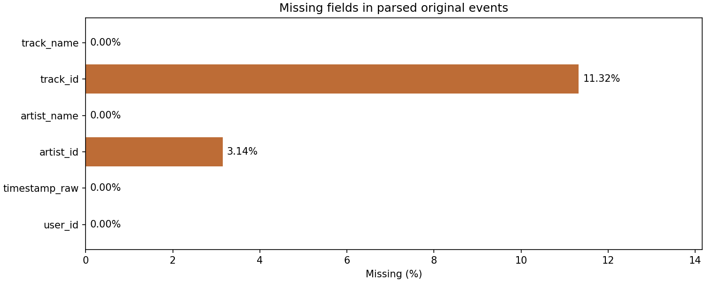
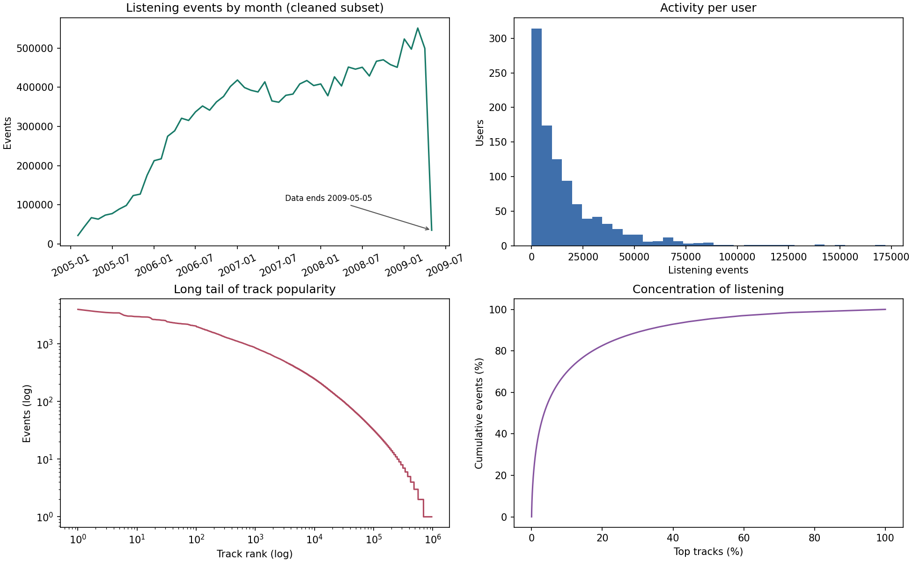

# EDA Last.fm 1K và đối chiếu catalog iTunes/Jamendo

> Báo cáo được tạo từ file gốc đầy đủ, không lấy mẫu và không dùng bản Parquet đã làm sạch sẵn.
> Lần chạy UTC: 2026-10-30T08:44:15.265430+00:00. Chưa huấn luyện mô hình và chưa gọi Supabase.

## 1. Dữ liệu này có giống dữ liệu đang thu thập không?

**Giống một phần metadata, khác đơn vị quan sát và mục đích sử dụng.**
Adapter iTunes/Jamendo hiện trả một record bài hát. Last.fm trả một lượt nghe
gắn user, bài và thời điểm; cùng một bài có thể xuất hiện nhiều lần.

| Last.fm TSV | Model provider hiện tại | Nhận xét |
|---|---|---|
| `track_name` | `title` | Cùng ý nghĩa, có thể khác cách viết |
| `artist_name` | `artist_name` | Cùng ý nghĩa |
| `track_id` | `external_id` | Khác hệ ID: MusicBrainz và provider; không join trực tiếp |
| `artist_id` | `artist_external_id` | Khác hệ ID, nhiều giá trị có thể thiếu |
| `user_id` | Không có | Lịch sử hành vi, cần cho lọc cộng tác |
| `timestamp` | Không có | Thời điểm nghe; KHÔNG phải ngày phát hành |
| Không có | album, duration, release_date, cover | Chưa đủ đặc trưng cho content model phong phú |
| Không có | preview/audio URL, license | Không phục vụ playback như catalog provider |
| Không có | explicit | Không suy ra từ lượt nghe |

Kết luận: dùng Last.fm cho **EDA hành vi, ALS và mô phỏng xu hướng theo thời gian**;
giữ iTunes/Jamendo cho **catalog và demo playback**. Chưa đo giao bài hát giữa các
nguồn vì repository chưa có tập dữ liệu provider thật được lưu để đối chiếu.
Không khẳng định cùng tên là cùng bản thu, không tự ghép ID và không nhập benchmark
vào database ứng dụng trong bước này.

## 2. Nguồn, định dạng và tính toàn vẹn

- Tác giả gốc: Òscar Celma, MTG/UPF; dữ liệu lịch sử Last.fm.
- [Trang nguồn gốc](https://ocelma.net/MusicRecommendationDataset/lastfm-1K.html).
- [Mirror công khai và README gốc](https://github.com/eifuentes/lastfm-dataset-1K).
- [File ZIP đã tải](https://github.com/eifuentes/lastfm-dataset-1K/releases/download/v1.0/userid-timestamp-artid-artname-traid-traname.tsv.zip).
- README đi kèm: cho phép sử dụng phi thương mại, yêu cầu dẫn nguồn Last.fm.
- ZIP được tải từ mirror vì trang tác giả không truy cập ổn định trong phiên này.
- MD5 TSV khớp README gốc: **True**.
- MD5: `64747b21563e3d2aa95751e0ddc46b68`.
- SHA-256: `529b8f83aadabdead189de06d816e213557221b92cb43c46f25840e07ef3399a`.
- TSV: 2,529,193,595 bytes, 19,150,868 dòng vật lý.
- Không tải audio. Không thu thập profile nhân khẩu học vì chưa cần cho bài toán.

Định dạng TSV không có header, 6 cột phân cách bằng tab:

```text
user_id  timestamp  artist_id  artist_name  track_id  track_name
```

File được đọc như chuỗi, không coi dấu ngoặc kép trong tên bài là dấu quote CSV.
Các dòng không đủ/đúng 6 cột được ghi nhận là lỗi, không bỏ qua âm thầm.

## 3. Chất lượng dữ liệu gốc

| Chỉ tiêu | Kết quả |
|---|---:|
| Dòng đọc thành công | 19,150,868 |
| User khác nhau trong dữ liệu parse được | 992 |
| Track ID không rỗng, khác nhau trước lọc | 961,416 |
| Dòng lỗi cấu trúc | 0 |
| Timestamp thiếu/không parse được | 0 |
| Timestamp trước năm 1970 | 0 |
| Timestamp sau ngày cutoff 2009-05-05 | 153,473 |
| Track ID có giá trị nhưng sai cấu trúc UUID | 0 |

Khoảng thời gian parse được trước lọc: `2005-02-14 00:00:07+00:00` → `2013-09-29 18:32:04+00:00`.
Các ngày bất thường phải được phân tích trước khi dùng để tạo split và xu hướng.
Cutoff lấy theo phạm vi nguồn công bố (đến hết 05/05/2009 UTC), không tự dịch dữ liệu
sang năm hiện tại. Các nhóm lỗi có thể chồng nhau, không cộng chúng thành số dòng loại.

| Field | Số giá trị thiếu sau trim | Tỷ lệ trên dòng parse thành công |
|---|---:|---:|
| `user_id` | 0 | 0.00% |
| `timestamp_raw` | 0 | 0.00% |
| `artist_id` | 602,166 | 3.14% |
| `artist_name` | 0 | 0.00% |
| `track_id` | 2,168,588 | 11.32% |
| `track_name` | 0 | 0.00% |



Thiếu MBID không đồng nghĩa thiếu tên bài. Baseline dưới đây chọn strict track MBID
để tránh gộp nhầm các bài trùng tên; đây là quyết định tiền xử lý có mất dữ liệu.
Một biến thể sau có thể dùng khóa tên artist/title đã chuẩn hóa, nhưng phải đánh giá
rủi ro đồng danh và báo kết quả riêng.

## 4. Quy tắc tạo tập sạch cho EDA

1. Trim chuỗi, rỗng thành null, parse timestamp UTC.
2. Giữ user ID, tên artist, tên bài đầy đủ; yêu cầu track MBID đúng cấu trúc UUID.
3. Giữ event từ 01/01/1970 đến hết 2009-05-05 UTC.
4. Artist MBID được phép thiếu; không dùng tên artist để tự bịa MBID.
5. Loại các bản ghi trùng toàn bộ 6 field sau chuẩn hóa; giữ lượt nghe cùng bài ở timestamp khác.
6. Tổng hợp user–track thành `plays` khi tính ma trận; không xem từng event lặp là một cặp mới.

| Bước | Số event |
|---|---:|
| Parse được | 19,150,868 |
| Đủ điều kiện trước dedup | 16,847,267 |
| Trùng hoàn toàn được loại trong tập đủ điều kiện | 1 |
| Sau lọc và dedup | 16,847,266 |
| Tỷ lệ giữ so với dòng parse được | 87.97% |

Chưa lọc k-core hoặc chỉ lấy top user/item. Chưa phân phối train/test chính thức.
Tập này phản ánh quyết định strict-ID, không đại diện nguyên vẹn cho mọi record gốc.

## 5. Quy mô và hành vi sau làm sạch

| Chỉ tiêu | Giá trị |
|---|---:|
| Người dùng | 991 |
| Track MBID khác nhau | 956,603 |
| Artist MBID có giá trị, khác nhau | 83,680 |
| Cặp user–song khác nhau | 3,941,123 |
| Độ thưa ma trận user–song | 99.58% |
| Tỷ lệ event vượt lượt đầu của mỗi cặp user–song | 76.61% |
| Tỷ trọng lượt nghe của top 1% bài theo lượt nghe | 28.85% |
| Bài chỉ có một lượt nghe trong tập sạch | 261,552 |
| Track MBID có nhiều cách viết tên bài | 184 |

Độ thưa = `1 - số cặp user–song / (số user × số song)`.
Tỷ lệ nghe lại = `(event - cặp user–song) / event`; không phải tỷ lệ user nghe lại.
Số artist chỉ tính ID có giá trị, không phải tổng nghệ sĩ thật.
Sự phổ biến ở đây là số scrobble của nhóm người dùng trong dataset, chưa đại diện
cho xu hướng thị trường hoặc sở thích người dùng Việt Nam hiện tại.

| Phân bố | Min | Median | Mean | P90 | P99 | Max |
|---|---:|---:|---:|---:|---:|---:|
| Lượt nghe/user | 2 | 10,224.0 | 17,000.3 | 41,201.0 | 91,882.3 | 172,042 |
| Bài khác nhau/user | 2 | 2,717.0 | 3,976.9 | 8,743.0 | 21,802.1 | 59,850 |
| Lượt nghe/bài | 1 | 4.0 | 17.6 | 34.0 | 255.0 | 3,985 |



Trục thời gian dùng UTC. Lượt nghe theo tháng chịu ảnh hưởng số user hoạt động và
độ phủ thu thập; tăng theo tháng không tự chứng minh thị trường âm nhạc tăng trưởng.
Tháng đầu và cuối chỉ có độ phủ một phần; tháng 05/2009 kết thúc ở cutoff ngày 05,
nên mức giảm ở điểm cuối không chứng minh nhu cầu nghe nhạc giảm.
Chênh lệch mean/median và đồ thị đuôi dài cần được xét khi chọn baseline, trọng số
confidence và biện pháp tăng catalog coverage.

### Top 10 bài theo lượt nghe trong tập sạch

Tên hiển thị lấy biến thể xuất hiện nhiều nhất của mỗi track MBID; không gộp theo tên.

| Bài | Nghệ sĩ | Lượt nghe |
|---|---|---:|
| Such Great Heights | The Postal Service | 3,985 |
| Love Will Tear Us Apart | Boy Division | 3,657 |
| Karma Police | Radiohead | 3,517 |
| Soul Meets Body | Death Cab For Cutie | 3,464 |
| Supermassive Black Hole | Muse | 3,459 |
| Heartbeats | The Knife | 3,150 |
| Rebellion (Lies) | Arcade Fire | 3,046 |
| Starlight | Muse | 3,043 |
| When You Were Young | The Killers | 2,997 |
| Gimme More | Britney Spears | 2,985 |

## 6. Thử phân chia thời gian để xem rủi ro đánh giá

Đây là **split preview**, chưa phải đánh giá mô hình: chọn mốc phân vị 80% và 90%
timestamp trên tập sạch. Các event cùng timestamp nằm chung phía mốc để tránh
chia tùy tiện cùng một thời điểm. Khi làm thí nghiệm thật phải chốt protocol và
xây vocabulary/aggregate chỉ bằng train; EDA toàn tập không phải feature cho model.

- Mốc train/validation: `2008-10-09 00:16:21+00:00`.
- Mốc validation/test: `2009-01-26 02:57:39+00:00`.

| Split | Event |
|---|---:|
| train | 13,477,812 |
| validation | 1,684,727 |
| test | 1,684,727 |

- Event test có bài chưa xuất hiện trong train: 294,334.
- Track cold trong test so với train: 85,115.
- User trong test chưa có trong train: 81.
- Event test có cặp user–song đã xuất hiện trong train: 670,479.

Không loại vĩnh viễn mọi bài đã nghe: nhiều event test chính là hành vi nghe lại.
Nếu so sánh phương pháp chỉ gợi ý bài chưa nghe, cần định nghĩa target và candidate
universe riêng. Bài chưa xuất hiện trong train là *cold item theo interaction*,
không chứng minh vừa phát hành vì dataset không có release date.

## 7. Ý nghĩa đối với hệ thống của nhóm

- **ALS/CF:** có thể tạo ma trận user–song từ play count; ma trận thưa nên lưu sparse.
  Confidence cần giảm ảnh hưởng user nghe cực nhiều, thử log/cap trên train.
- **Sở thích và phiên:** có lịch sử theo thời gian, nhưng muốn session phải đặt
  quy tắc chia khoảng cách event và báo đó là suy diễn, không phải session gốc.
- **Xu hướng:** tính rolling popularity tại từng mốc lịch sử; không gọi đó là trend năm 2026.
- **Content-based:** artist và title có thể dùng baseline yếu; thiếu genre, album,
  mood/audio features nên chưa đánh giá được mô hình hiểu phong cách đầy đủ.
- **Skip/like/search:** không có trong TSV; không được suy ra mọi khoảng cách ngắn
  là skip hoặc bịa event để báo cáo như dữ liệu thật.
- **Thời lượng:** không có duration/listened_ms nên không tính completion rate đáng tin cậy.
- **Ứng dụng:** metadata provider phục vụ catalog; interaction benchmark không tự
  gắn với user/item của ứng dụng. Cần mapping có kiểm chứng hoặc train lại bằng event nội bộ.

## 8. Bước tiếp theo đề xuất

1. Dùng tập sạch làm đầu vào cho popularity và ALS baseline, chưa cần tải audio.
2. Chốt temporal protocol và báo riêng warm/cold item, warm/cold user.
3. Thử sensitivity theo cách xử lý missing MBID và mức lọc user/item; báo tỷ lệ mất dữ liệu.
4. Đánh giá NDCG/Recall và coverage; không đưa kết quả model khi mới hoàn thành EDA.
5. Duy trì importer iTunes/Jamendo như nhánh ứng dụng riêng. Sau khi có file metadata
   thật, đo giao catalog bằng mapping candidate + kiểm tra bản thu, không join theo tên đơn lẻ.

## 9. Tái lập

```bash
cd recommender/eda
uv sync --locked
uv run python lastfm_eda.py
```

File raw/duckdb/CSV tổng hợp lớn nằm trong `data/` được Git ignore. Báo cáo, metric
JSON, manifest và PNG nằm trong `docs/eda/lastfm-1k/`. Script không tự tải mạng;
lệnh tải và giải thích chi tiết nằm ở README cạnh script.
