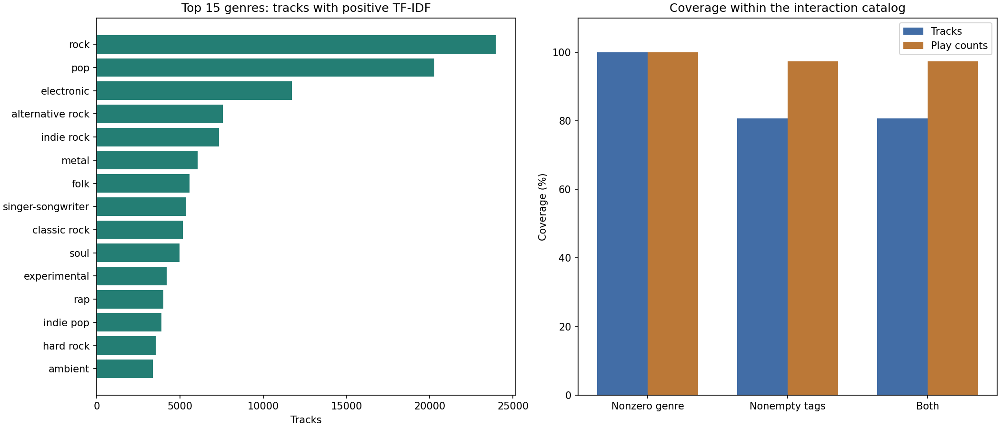

# Kiểm tra Music4All-Onion trước khi chọn làm dataset chính

> Phạm vi: metadata genre/tags và file user–track–count nếu có. Không training,
> không tải audio, không gọi iTunes/Jamendo/Supabase và không thay dataset hiện có.
> Thời điểm UTC: 2026-10-30T09:13:33.917005+00:00.

## 1. Nguồn và tính toàn vẹn

[Music4All-Onion v2, DOI 10.5281/zenodo.15394646](https://zenodo.org/records/15394646) là nguồn phát hành.
Script so MD5 các file nén với checksum công bố, đồng thời lưu SHA-256 trong manifest.
Không tải toàn bộ các feature audio/video/lyrics khoảng 20 GB.

| File | Dung lượng nén (bytes) | Kiểm tra MD5 |
|---|---:|---|
| `README.md` | 20,493 | Đạt |
| `id_genres_tf-idf.tsv.bz2` | 2,963,194 | Đạt |
| `id_tags_dict.tsv.bz2` | 14,817,003 | Đạt |
| `userid_trackid_count.tsv.bz2` | 550,649,499 | Đạt |

README nguồn giải thích cấu trúc feature và interaction. Điều kiện sử dụng của
metadata/feature không tự cấp quyền phát các bản nhạc gốc. Bước này chỉ phân tích
các file nghiên cứu, chưa xác nhận khả năng playback hoặc metadata tên bài đầy đủ.

## 2. Cấu trúc dữ liệu thật

### Genre TF-IDF

```text
id    genre_1    genre_2    ...    genre_N
```

Header thực tế có 685 cột genre ngoài cột ID. Mỗi hàng là
một vector feature của bài hát. Trọng số dương thể hiện genre có mặt trong biểu diễn;
trọng số TF-IDF không phải xác suất và không bắt buộc nằm trong [0,1].

### Tags

```text
id    (tag, weight)
```

Cột thứ hai chứa dictionary theo cú pháp Python, ví dụ `{'pop': 100}`, không phải
JSON chuẩn. Script dùng `ast.literal_eval`, không dùng `eval`. Tags có thể là genre,
mood, địa điểm hoặc nhãn cá nhân; không xem mọi tag đều là thể loại âm nhạc.

### Interaction

```text
user_id    track_id    count
```

ID của các file trong Music4All-Onion được so khớp theo chuỗi ID nội bộ. Chưa có
bằng chứng các ID này trùng MusicBrainz ID của Last.fm 1K hoặc ID của Jamendo.
Không join chéo các dataset theo ID chỉ vì cả hai đều có cột `trackid`.

## 3. Chất lượng metadata

| Chỉ tiêu | Kết quả |
|---|---:|
| Dòng genre | 109,269 |
| Bài có vector genre khác 0 | 109,242 |
| Bài có vector genre toàn 0 | 27 |
| Vector genre không hợp lệ | 0 |
| Dòng tags | 109,269 |
| ID khác nhau trong file tags | 108,286 |
| Dòng lặp ID trong file tags | 983 |
| ID có tập tag dương khác nhau giữa các dòng lặp | 0 |
| Bài có ít nhất một tag dương | 88,092 |
| Dictionary tags không hợp lệ | 0 |
| Số tên tag dương khác nhau sau trim/casefold | 257,510 |
| Giao ID của hai file metadata | 108,286 |
| Bài có cả genre và tags hữu dụng | 88,068 |

Script yêu cầu ID không rỗng; từ chối lỗi cấu trúc và ID genre trùng. Với tags,
ID lặp được đếm rõ và hợp nhất tập tag dương, không cộng dồn trọng số hoặc đếm
một track nhiều lần trong biểu đồ tần suất. Vector genre
chỉ hợp lệ nếu mọi phần tử hữu hạn, không âm. Trọng số tags được kiểm tra tương tự.
Vector toàn 0 hoặc dict không có tag dương là metadata không hữu dụng, dù vẫn có ID.

## 4. Độ phủ interaction với metadata

Đã phân tích **toàn bộ file interaction count**, không lấy mẫu.

| Chỉ tiêu đo trực tiếp | Kết quả |
|---|---:|
| Dòng user–track–count | 50,016,042 |
| Cặp user–track khác nhau | 50,016,042 |
| Dòng cặp bị lặp | 0 |
| Người dùng | 119,140 |
| Bài xuất hiện trong interaction | 56,512 |
| Tổng lượt nghe từ sum(count) | 252,984,396 |
| Độ thưa user–song | 99.26% |
| User có tương tác với bài đủ genre và tags | 119,126 |

Một dòng là một cặp user–track với tổng lượt nghe, không phải một event riêng lẻ.
Độ phủ theo cặp và độ phủ theo lượt nghe có mẫu số khác nhau.

| Điều kiện | Bài | % bài trong interaction | % dòng cặp | % lượt nghe |
|---|---:|---:|---:|---:|
| Có dòng genre (kể cả vector rỗng) | 56,512 | 100.00% | 100.00% | 100.00% |
| Có ít nhất một genre trọng số dương | 56,498 | 99.98% | 99.99% | 99.99% |
| Có dòng tags | 56,155 | 99.37% | 99.96% | 99.95% |
| Có ít nhất một tag trọng số dương | 45,589 | 80.67% | 97.00% | 97.36% |
| Có cả genre và tags hữu dụng | 45,577 | 80.65% | 96.99% | 97.35% |

Có 52,744 bài có genre
nhưng không có interaction trong file count này. Có thể dùng để nghiên cứu item
không có tương tác, nhưng không gọi đó là bài mới phát hành vì chưa có release date.


## 5. Phân bố thể loại

| Genre | Số bài có trọng số dương |
|---|---:|
| rock | 23,949 |
| pop | 20,267 |
| electronic | 11,739 |
| alternative rock | 7,591 |
| indie rock | 7,353 |
| metal | 6,067 |
| folk | 5,580 |
| singer-songwriter | 5,379 |
| classic rock | 5,180 |
| soul | 4,975 |
| experimental | 4,194 |
| rap | 4,012 |
| indie pop | 3,890 |
| hard rock | 3,547 |
| ambient | 3,375 |

Đây là phân bố theo file genre toàn catalog, không chỉ tập interaction. Một bài có
thể có nhiều genre nên không cộng số lượt nhãn thành số bài. Các nhãn thưa và lệch
phân bố cần được xét khi chọn baseline và đánh giá theo genre.



## 6. Khả năng đáp ứng đề tài

| Yêu cầu | Khả năng của các file đã kiểm tra |
|---|---|
| Lọc cộng tác từ lịch sử | File count cho phép tạo ma trận sparse user–song |
| Gợi ý theo genre/tags | Dùng vector genre và tags sau xử lý thiếu/rỗng |
| Cá nhân hóa content | Tổng hợp feature từ bài user nghe để tạo user profile |
| Xu hướng gần đây | Chưa đo được bằng count tổng; cần timestamp |
| Thứ tự phiên, temporal split | Chưa làm vì chưa tải file timestamp |
| Skip, like, search | Không có trong các file đang phân tích |
| Audio, phát nhạc trên website | Không có trong các file đã tải |
| Tên bài, artist, album cho UI | Chưa xác nhận trong các file hiện có; cần metadata gốc |
| Bài mới từ Jamendo | Cần importer và mapping catalog riêng |

So với Last.fm 1K, ưu điểm là có feature genre/tags và interaction dùng cùng hệ ID
nội bộ. Chỉ đo độ phủ thực tế, không suy ra mọi bài trong catalog đều có lịch sử.
Đây vẫn là dữ liệu lịch sử và không phản ánh xu hướng hiện nay.

## 7. Hướng sử dụng sau kiểm tra

Với mục tiêu thử hệ lai có thể loại, dữ liệu đã đo phù hợp hơn Last.fm 1K không có sẵn genre. Nên bắt đầu với genre làm feature chính: giữ 56,498 bài, bao phủ 99.99% lượt nghe. Tags là feature bổ sung; nếu bắt buộc có cả hai thì chỉ giữ 80.65% bài nhưng giữ 97.35% lượt nghe, nên có nguy cơ thiên về bài phổ biến. Chưa kết luận mô hình chính xác hơn khi chưa train và đánh giá.

1. Dùng phần giao có metadata hữu dụng để thử popularity, content-based và ALS.
2. Báo riêng kết quả khi giữ hoặc loại bài thiếu genre; tránh chỉ chọn nhóm thuận lợi.
3. Genre TF-IDF được cung cấp sẵn là biến đổi của tác giả; chưa tái lập IDF trên train.
   Khi cần protocol nghiêm ngặt, cân nhắc xây lại feature từ nhãn gốc hoặc binarize
   có giải thích. Không dùng lượt nghe trong test để tạo profile hoặc score xu hướng.
4. Tải timestamp như bước riêng sau khi chốt dataset; kiểm tra ngày và temporal split.
5. Dùng Jamendo cho nhánh ứng dụng, chưa gắn model benchmark trực tiếp vào catalog
   provider nếu chưa kiểm tra mapping và quyền playback.

## 8. Tái lập

```bash
cd recommender/eda
uv run python download_music4all.py --include-interactions
uv run python music4all_audit.py
```

Script audit không có truy cập mạng. File lớn nằm ở `data/` đã Git ignore. Báo cáo,
biểu đồ, metrics và manifest ở `docs/eda/music4all-onion/`. Không huấn luyện model.
